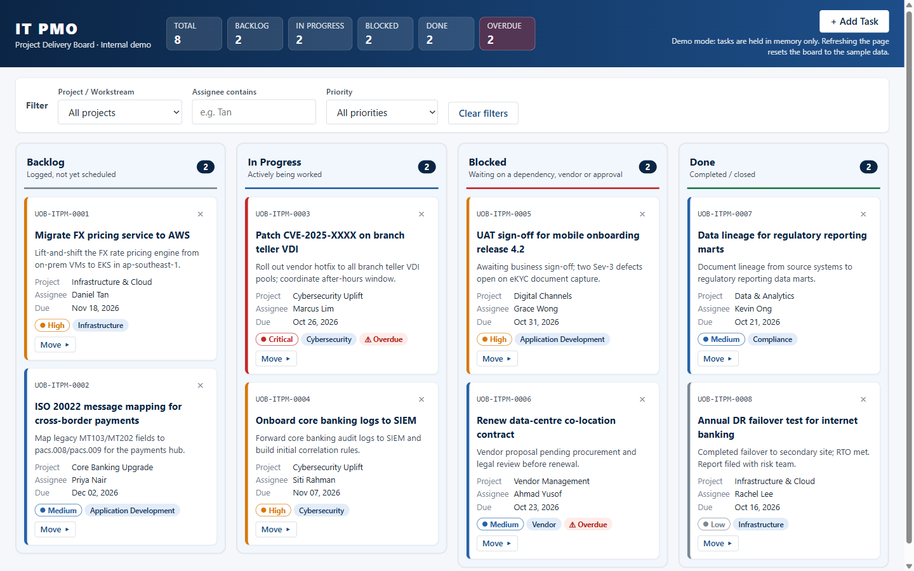

# kanban8 — IT PMO Kanban Board

A single-file Kanban board for the IT Project Management Office of a fictitious bank, built as an internal demo/training app. It is plain HTML, CSS and JavaScript in one `index.html`, with no build step and no dependencies.

**Live demo:** https://alfredang.github.io/kanban8/



## Features

- Four status columns: Backlog, In Progress, Blocked and Done.
- A header summary strip with counts per status and an overdue count.
- Filters for project/workstream, assignee (contains) and priority.
- An Add Task form with validation. New tasks get IDs like `UOB-ITPM-0009`.
- Two ways to move cards: drag and drop, or the keyboard-accessible **Move ▸** menu.
- Inline delete confirmation, focus restoration after every re-render, screen-reader announcements, and support for `prefers-reduced-motion`.
- An optional email notification for each new task, sent through [FormSubmit](https://formsubmit.co).

### Demo data, not real data

- **The board is in memory only.** Refreshing the page resets it to the 8 sample tasks.
- The sample tasks, people, projects and dates are all made up. Seed due dates are set relative to today, so the "Overdue" examples are always overdue.
- The email address is a placeholder (`YOUR_EMAIL@example.com`), so no notification goes anywhere until you configure it (see below).

## Run locally

Either open `index.html` directly in a browser, or serve the folder:

```bash
python -m http.server 8000
# then open http://localhost:8000/
```

Serving over HTTP is the better option if you want to test the FormSubmit email call.

## Configuration

All configuration is in the `CONFIG` block at the top of the `<script>` in `index.html`:

| Constant | Purpose |
| --- | --- |
| `FORMSUBMIT_ENDPOINT` | `https://formsubmit.co/ajax/<your-address>`. Replace `YOUR_EMAIL@example.com`. |
| `ID_PREFIX` | Prefix for task IDs (`UOB-ITPM-`) |
| `EMAIL_SUBJECT_TAG` | Subject-line tag on notification emails |

`FormSubmit` setup:

1. Put your address in `FORMSUBMIT_ENDPOINT`. That constant is the only place the code reads it from. The HTML comment above the script and `CLAUDE.md` also mention the placeholder, but they are documentation only.
2. Add one task. FormSubmit then sends a **one-time activation email** to that address.
3. Click the activation link. Nothing is delivered until you do. Before activation, FormSubmit can answer HTTP 200 with `success: "false"`, and the app treats that answer as a failure.

The task is always added to the board first. If the email fails, you only see a warning toast and the card stays on the board.

Reference data lives in constants near the top of the script: `STATUSES`, `PROJECTS`, `CATEGORIES` and `PRIORITIES`. These constants fill the dropdowns and act as allow-lists for validation. The CSS has rules keyed on status and priority values (`.column[data-status="…"]` and `.card.prio-<slug>`), so **if you rename a value, update the matching CSS as well**.

## Deployment

[`.github/workflows/pages.yml`](.github/workflows/pages.yml) runs on GitHub Actions:

- **`check`** runs on every push, pull request and manual dispatch. It scans the full git history for secrets with gitleaks, fails if `index.html` is missing, and fails if `FORMSUBMIT_ENDPOINT` no longer uses the placeholder address (so a real address can't reach the public site by accident).
- **`deploy`** runs after `check` passes on a push to `main` or a manual `workflow_dispatch`. It copies only the public site files (`index.html` and `docs/`) into `_site/` and publishes that to GitHub Pages. `CLAUDE.md`, `.github/` and other repo files are not deployed.

## Project structure

```
index.html                     The whole app: HTML, CSS and JS
docs/screenshot.png            Screenshot used in this README
.github/workflows/pages.yml    CI checks and GitHub Pages deploy
CLAUDE.md                      Architecture notes for AI coding assistants
README.md                      This file
```

## Contributing notes

- Keep everything in `index.html`. Don't add a build step, package manager or framework.
- The code follows a "mutate `state`, then call `renderBoard()`" pattern. There is no incremental DOM patching.
- Any user-supplied value that goes into a template string must pass through `escapeHtml()`. Toasts use `textContent`.
- Card actions use event delegation with `data-action`. To add one, add a button in `renderCard()` and a matching `case` in `handleBoardClick`.
- Before re-rendering, set `state.ui.focus` so keyboard users keep their place.
- Use the CSS custom properties in `:root` (palette, `--space-1..6`, radii, shadows) instead of hard-coded values. Put new code in the numbered banner-comment section it belongs to.
- The responsive breakpoints are 1100px (two columns) and 767px (one column).

See [`CLAUDE.md`](CLAUDE.md) for a fuller architecture walkthrough.

## Testing

There is no automated test suite. To test, open the page and work through the flows by hand: add a task (including the validation errors), filter, drag and drop, use the Move menu with the keyboard, delete, and check the layout at the 1100px and 767px breakpoints.
